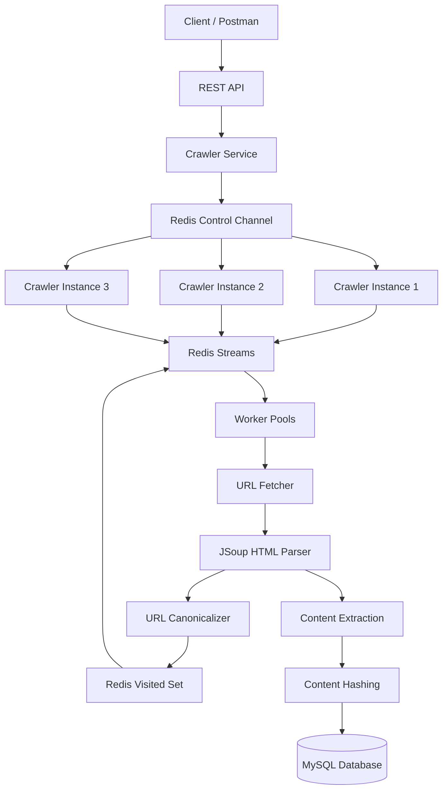
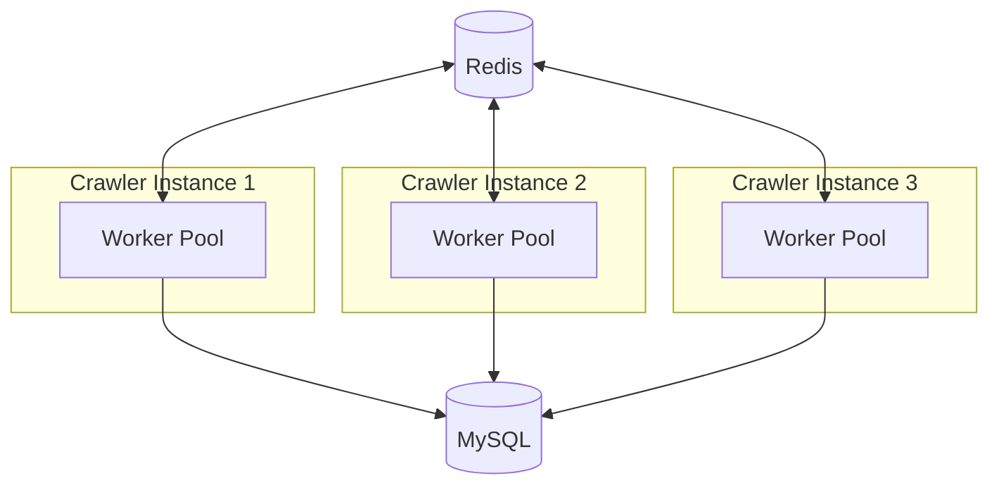

# Multithreaded Distributed Web Crawler & Scraper

A Java-based web crawler that fetches web pages, extracts useful information, and stores the results in MySQL.

The project uses multithreading to process multiple URLs concurrently and Redis to distribute crawling tasks across multiple application instances. It also includes URL canonicalization, distributed URL deduplication, and content hashing.

The application runs using Docker Compose, making it easy to start and test multiple crawler instances on a local machine.

## Features

- **Multithreading:** Processes multiple URLs concurrently using worker threads.
- **Horizontal Scaling:** Runs multiple crawler instances that share work through Redis.
- **Distributed Task Queue:** Uses Redis Streams and consumer groups to distribute crawling tasks.
- **URL Canonicalization:** Normalizes URLs before adding them to the crawl queue.
- **Distributed Deduplication:** Uses a Redis Set to avoid processing the same canonical URL multiple times.
- **Content Hashing:** Generates a hash of page content to help identify identical content.
- **HTML Parsing:** Extracts page titles, descriptions, text, and links using JSoup.
- **MySQL Storage:** Saves crawled page information in a database.
- **Database Migrations:** Uses Flyway to manage database schema changes.
- **Crawl Depth Tracking:** Tracks how far a URL is from the original seed URL.
- **Crawl Control:** Supports starting and stopping crawling through REST APIs.
- **Docker Support:** Runs the application and its dependencies using Docker Compose.

## 1. Project Architecture

The application consists of multiple crawler instances, a shared Redis service, and a MySQL database.

Each crawler instance has its own worker pool. Redis handles task distribution and coordination, while MySQL stores the crawled page data.



### Main Components

| Component | Responsibility |
|---|---|
| Crawler Service | Handles crawl requests and control operations. |
| Crawler Engine | Coordinates the crawling process. |
| Crawl Coordinator | Manages URL deduplication and task coordination. |
| Crawl Queue | Distributes tasks using Redis Streams. |
| Worker Pool | Processes multiple crawling tasks concurrently. |
| URL Fetcher | Sends HTTP requests and retrieves web pages. |
| JSoup Parser | Extracts page content, titles, descriptions, and links. |
| URL Canonicalizer | Normalizes URLs before processing. |
| Redis | Handles distributed coordination, task distribution, and visited URL tracking. |
| MySQL | Stores the crawled page data. |

## 2. How Crawling Works

The crawling process follows these steps:

1. The client submits a seed URL through the REST API.
2. The crawler service receives the request and publishes a start command through Redis.
3. The crawler instances receive the command and begin processing tasks.
4. The seed URL is canonicalized to normalize its format.
5. Redis checks whether the URL has already been visited.
6. New URLs are added to the distributed crawl queue.
7. A worker fetches the page using Java's `HttpClient`.
8. JSoup parses the HTML and extracts the title, description, page content, and links.
9. A content hash is generated for the crawled page.
10. The extracted page data is saved in MySQL.
11. Discovered links are canonicalized and checked against the Redis visited set.
12. New URLs are added to the queue and processed by available workers.

The process continues until the configured crawl limits are reached or crawling is stopped.

## 3. Multithreaded Crawling

Each crawler instance uses a local worker pool to process multiple URLs at the same time.

For example:

```text
Crawler Instance
       |
       v
  Worker Pool
       |
       +---- Worker 1
       |
       +---- Worker 2
       |
       +---- Worker 3
       |
       +---- Worker 4
       |
       +---- Worker 5
```

The workers fetch pages, parse HTML, and save the results without requiring the entire crawl to run sequentially.

The project uses concurrent data structures and a blocking queue where appropriate to support thread-safe task processing.

## 4. Horizontal Scaling

The application can run multiple crawler instances simultaneously.



All instances use the same Redis service and MySQL database.

Redis allows them to coordinate their work instead of maintaining completely separate crawling queues and visited URL registries.

Additional crawler instances can be started through Docker Compose without changing the core crawling logic.

## 5. Redis-Based Task Distribution

The project uses **Redis Streams and consumer groups** to distribute crawling tasks between crawler instances.

The Redis Stream acts as a shared task queue.

Each instance uses a consumer identity, allowing multiple instances to read tasks from the same stream.

The implementation also includes handling for pending tasks so that abandoned work can be recovered.

Redis is used for:

- Distributing crawl tasks.
- Tracking visited URLs.
- Publishing crawler control commands.
- Coordinating multiple instances.
- Handling pending tasks and recovery.

The current configuration uses three Redis consumer threads per crawler instance. With three instances, that gives a total of nine consumer threads.

These consumers are separate from the local worker pools that process crawling tasks.

## 6. URL Canonicalization

Different URLs can point to the same page. The crawler normalizes URLs before checking whether they have already been visited.

Examples:

| Original URL | Canonical URL |
|---|---|
| `HTTPS://Example.COM/page` | `https://example.com/page` |
| `https://example.com/page#section` | `https://example.com/page` |
| `https://example.com/page?utm_source=google` | `https://example.com/page` |
| `https://example.com:443/page` | `https://example.com/page` |
| `https://example.com/product?id=123` | `https://example.com/product?id=123` |

The canonicalizer removes tracking parameters such as `utm_source`, `utm_medium`, `utm_campaign`, `fbclid`, and `gclid`.

Meaningful query parameters are preserved.

The canonicalization process is implemented in the `UrlCanonicalizer` service using Java's URI API.

### Canonicalization Flow

```text
Discovered URL
      |
      v
UrlCanonicalizer
      |
      v
Canonical URL
      |
      v
Redis Visited Set
      |
      +---- Already visited --> Skip
      |
      +---- New URL ---------> Add to Crawl Queue
```

This reduces unnecessary crawling of URLs that differ only in fragments, tracking parameters, or other normalized components.

## 7. Distributed URL Deduplication

The crawler uses a Redis Set named:

```text
crawler:visited
```

When a URL is discovered, the crawler canonicalizes it and attempts to add it to the Redis Set using the `SADD` operation.

- If the URL is new, Redis adds it to the set.
- If the URL already exists, Redis rejects the duplicate insertion.

Because Redis handles this operation atomically, multiple crawler instances can share the same visited URL registry.

This helps prevent the same canonical URL from being scheduled repeatedly by different instances.

## 8. Content Hashing

The crawler generates a SHA-256 hash of the crawled page content and stores it alongside the page data.

```text
Fetched Page Content
         |
         v
     SHA-256
         |
         v
    Content Hash
         |
         v
    MySQL Database
```

The hash provides a compact representation of the content and can be used to compare pages.

For example, identical content can produce the same hash when the same hashing procedure and input bytes are used.

This feature can support future improvements such as duplicate-content detection and identifying changes between crawls.

**Note:** Storing content hashes alone does not automatically detect changes over time. That requires comparing hashes from different crawls of the same page.

## 9. HTML Scraping

The project uses JSoup to parse the HTML returned by the URL fetcher.

The scraper extracts the following information:

- Page title.
- Meta description.
- Page text content.
- Links found on the page.
- HTTP response status.
- Crawl depth.
- Content hash.

The extracted links are passed back to the crawling process, where they are canonicalized and checked for duplicates.

The HTTP fetching component uses Java's `HttpClient` to send requests and retrieve page responses.

Some websites may return `403 Forbidden` or `429 Too Many Requests` responses because of their access policies or request limits.

## 10. Database and Persistence

MySQL stores information about the crawled pages in the `crawled_pages` table.

The table includes fields such as:

| Field | Description |
|---|---|
| `id` | Unique record identifier. |
| `url` | Crawled page URL. |
| `title` | Page title. |
| `description` | Meta description. |
| `content` | Extracted page content. |
| `http_status` | HTTP response status code. |
| `depth` | Distance from the seed URL. |
| `content_hash` | Hash of the page content. |
| `status` | Crawl processing status. |
| `crawled_at` | Time when the page was crawled. |

A unique constraint on the URL provides additional protection against duplicate database records.

Flyway manages database schema changes through versioned SQL migration files.

Example migration directory:

```text
src/main/resources/db/migration/
├── V1__create_crawled_pages.sql
├── V2__...
└── V3__...
```

This makes database changes easier to track and apply consistently across environments.

## 11. Crawl Depth

Each crawling task contains a depth value.

The seed URL starts at depth `0`. Links discovered on that page are assigned depth `1`, and links found on those pages are assigned the next depth.

```text
Seed URL                    Depth 0
   |
   +---- Page A              Depth 1
   |       |
   |       +---- Page C      Depth 2
   |
   +---- Page B              Depth 1
           |
           +---- Page D      Depth 2
```

The crawler uses the configured maximum depth to limit how far it follows links.

This helps control the size of a crawl and prevents the crawler from following links indefinitely.

## 12. Project Structure

The main source code is organized into packages based on responsibility.

```text
src/
└── main/
    ├── java/
    │   └── com/
    │       └── crawler/
    │           ├── config/
    │           │   ├── CrawlerControlListener.java
    │           │   ├── CrawlerControlPublisher.java
    │           │   └── ...
    │           │
    │           ├── controller/
    │           │   └── ...
    │           │
    │           ├── crawler/
    │           │   ├── CrawlQueue.java
    │           │   ├── CrawlTask.java
    │           │   ├── CrawlerEngine.java
    │           │   └── Worker.java
    │           │
    │           ├── concurrency/
    │           │   ├── CrawlCoordinator.java
    │           │   ├── CrawlTaskExecutor.java
    │           │   └── ThreadPoolConfig.java
    │           │
    │           ├── model/
    │           │   ├── CrawledPage.java
    │           │   └── UrlStatus.java
    │           │
    │           ├── repository/
    │           │   └── CrawledPageRepository.java
    │           │
    │           └── service/
    │               ├── CrawlerService.java
    │               ├── ScraperService.java
    │               ├── UrlCanonicalizer.java
    │               └── UrlFetcherService.java
    │
    └── resources/
        ├── application.properties
        └── db/
            └── migration/
                └── V1__create_crawled_pages.sql

Dockerfile
docker-compose.yaml
nginx.conf
pom.xml
README.md
```

The structure separates crawling logic, concurrency management, database access, configuration, and application services.

## 13. Technology Stack

| Technology | Purpose |
|---|---|
| Java 17 | Core programming language. |
| Spring Boot | Application framework and REST APIs. |
| Maven | Dependency management and build tool. |
| Java HttpClient | Fetches web pages over HTTP. |
| JSoup | Parses HTML and extracts page information. |
| MySQL 8 | Persistent storage. |
| Redis | Distributed coordination and shared state. |
| Redis Streams | Distributed task processing. |
| Flyway | Database migrations. |
| Docker | Containerization. |
| Docker Compose | Runs multiple application instances and supporting services. |
| Nginx | Available for reverse-proxy or load-balancing configuration. |
| Postman | API testing. |

## 14. Running the Project

### Prerequisites

Install the following:

- Java 17.
- Maven.
- Docker Desktop or Docker Engine with the Docker Compose plugin.
- Postman (optional, for testing the API).

Docker Compose is used to start the application and its dependencies.

### Step 1: Clone the Repository

```bash
git clone https://github.com/yashbhatt1979/multithreaded-web-crawler.git
```

Move into the project directory:

```bash
cd multithreaded-web-crawler
```

### Step 2: Build the Application

Run:

```bash
mvn clean package -DskipTests
```

This compiles the application and packages it into a JAR file without running the test suite.

### Step 3: Start the Docker Environment

Run:

```bash
docker compose up -d --build
```

This builds the application image and starts the services defined in `docker-compose.yaml`.

### Step 4: Check the Containers

```bash
docker compose ps
```

Check the logs for an individual crawler:

```bash
docker compose logs -f crawler-1
```

To view logs from all three instances:

```bash
docker compose logs -f crawler-1 crawler-2 crawler-3
```

Use the actual service names defined in your Compose file if they differ.

## 15. API Endpoints

The crawler exposes REST endpoints under `/api/crawler`.

### Start Crawling

**Method:** `POST`

**Endpoint:**

```http
POST /api/crawler/start?url=https://example.com
```

Using cURL:

```bash
curl -X POST "http://localhost:8080/api/crawler/start?url=https://example.com"
```

Replace the example URL with the seed URL you want to crawl.

### Stop Crawling

**Method:** `POST`

```http
POST /api/crawler/stop
```

Using cURL:

```bash
curl -X POST "http://localhost:8080/api/crawler/stop"
```

### Check Status

Use the status endpoint implemented in the project to inspect the crawler's current state.

The exact path and response format depend on the controller implementation.

## 16. Useful Redis Commands

The following commands can help inspect the crawler's distributed state.

### View Visited URLs

```bash
redis-cli SMEMBERS crawler:visited
```

### Count Visited URLs

```bash
redis-cli SCARD crawler:visited
```

### Clear Visited URLs

```bash
redis-cli DEL crawler:visited
```

**Warning:** Clearing the visited set removes the crawler's URL deduplication history. Do this only when you want to reset that state for a fresh crawl.

If Redis is running inside Docker, execute these commands inside the Redis container:

```bash
docker exec -it crawler-redis redis-cli
```

Replace `crawler-redis` with the actual Redis container name if necessary.

## 17. Checking the Database

Connect to MySQL and select the database configured for the application.

### View Recently Crawled Pages

```sql
SELECT
    id,
    url,
    status,
    http_status,
    depth,
    crawled_at
FROM crawled_pages
ORDER BY crawled_at DESC;
```

### Count Stored Pages

```sql
SELECT COUNT(*)
FROM crawled_pages;
```

### Inspect Content Hashes

```sql
SELECT
    url,
    content_hash
FROM crawled_pages;
```

These queries help verify that pages are being crawled and their information is being stored correctly.

## 18. Testing Horizontal Scaling

To test the distributed setup, start three crawler instances:

```text
crawler-1
crawler-2
crawler-3
```

Submit a seed URL through the API and inspect the logs.

Check that:

- The crawler instances receive the start command.
- Tasks are distributed through Redis Streams.
- Workers process URLs concurrently.
- Canonical URLs are used for deduplication.
- Duplicate URLs are not unnecessarily processed.
- Crawled page information is saved in MySQL.
- Content hashes are stored with the page records.
- Pending tasks can be recovered where supported by the implementation.

Also check the MySQL records to confirm that the crawler is persisting the results.

## 19. Stopping the Environment

To stop and remove the containers created by Docker Compose, run:

```bash
docker compose down
```

This stops the services and removes their containers and network. Persistent data is retained only if it is stored in a volume or another persistent storage location that is not removed.

## 20. System Design Concepts

This project provides practical experience with several backend and system design concepts.

**Concurrency**
- Thread pools and worker threads.
- Concurrent task execution.
- Thread-safe data structures.
- Blocking queues.

**Distributed Systems**
- Multiple application instances.
- Shared Redis state.
- Distributed task queues.
- Consumer groups.
- Pending task recovery.

**Scalability**
- Horizontal scaling.
- Shared coordination between instances.
- Independent worker pools.

**Data Management**
- URL canonicalization.
- Distributed deduplication.
- Database uniqueness constraints.
- Content hashing.
- Database migrations.

**Reliability**
- Task recovery.
- Crawl control.
- Persistent storage.
- Handling HTTP failures.

## 21. Possible Improvements

Some features that could be added in future versions include:

- Retry handling with exponential backoff.
- Per-domain rate limiting.
- `robots.txt` support.
- Better handling of HTTP errors.
- Prioritization of crawl tasks.
- Metrics using Prometheus.
- Monitoring dashboards with Grafana.
- Distributed tracing.
- Content-change detection across multiple crawls.
- Database sharding.
- Improved recovery for failed tasks.
- Dynamic scaling of crawler instances.

These improvements would make the crawler more reliable and easier to monitor when processing larger workloads.

## Conclusion

This project started as a multithreaded web crawler and was extended to support multiple crawler instances working together.

It combines Java concurrency, Spring Boot, Redis, MySQL, HTML parsing, URL canonicalization, content hashing, and Docker-based deployment.

The main focus is on understanding how crawling tasks can be processed concurrently, distributed across multiple instances, and stored reliably in a shared database.